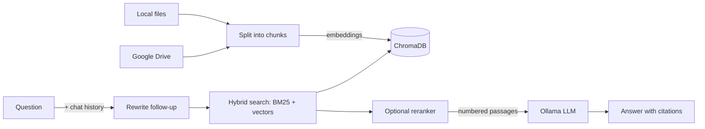

# 📚 PrivateRAG

**A small, readable, well-tested RAG app you can run entirely on your own machine, and fork as a starting point for your own.**

[](https://github.com/husseinzayat3/PrivateRAG/actions/workflows/ci.yml)
[](https://github.com/husseinzayat3/PrivateRAG/releases)
[](https://www.python.org/downloads/)
[](LICENSE)

Chat with your PDFs, notes, spreadsheets and Google Drive folders. Answers cite the passages they came from, so you can check every claim.

<!-- TODO: replace with docs/demo.gif once recorded -->


**Private by design.** The language model (via [Ollama](https://ollama.com/)), the embeddings, the vector index and your chat history all run and stay on your machine. Your documents, questions and answers are never sent to a third-party service. The only network traffic is downloading models and, if you use it, reading from Google Drive. Usage telemetry from Streamlit, Chroma and Hugging Face Hub is turned off. [Details](docs/TROUBLESHOOTING.md#privacy-what-goes-over-the-network).

## ✨ Features

- **Cited answers.** Every answer cites its passages (`[1]`, `[2]`), and **Sources** shows each one with its file and page.
- **Hybrid search.** BM25 keyword search fused with vector search finds exact names, IDs and error codes as well as paraphrases. MMR, plain vector search and an optional cross-encoder reranker are one setting away.
- **Your documents:** `.pdf`, `.txt`, `.md` and `.csv` files, plus Google Docs, Sheets, Slides and PDFs from [Google Drive](docs/GOOGLE_DRIVE.md).
- **Index management.** See what's indexed, remove documents, and clean up deleted files. Re-ingesting an edited file replaces only what changed.
- **Conversational.** Follow-ups like "who owns the second one?" are rewritten using the chat history before searching. Answers stream token by token.
- **Chat history**, saved locally, with a URL per chat.
- **Small and tested.** About 1,100 lines of Python, 60+ tests, CI on Python 3.10–3.14, and an [architecture guide](docs/ARCHITECTURE.md) for forking it.

## 🚀 Quick start (Docker)

You only need [Docker](https://docs.docker.com/get-docker/):

```bash
git clone https://github.com/husseinzayat3/PrivateRAG.git
cd PrivateRAG
docker compose up
```

Then open **http://localhost:8501**. The first start downloads the chat model (about 4.9 GB for `llama3.1`; follow along with `docker compose logs -f ollama-init`). Later starts take seconds and work offline.

- **Your documents:** put files in `./data`, or upload them in the sidebar.
- **NVIDIA GPU:** `docker compose -f docker-compose.yml -f docker-compose.gpu.yml up`
- **Mac:** Docker can't use the Apple GPU. For faster answers, [run Ollama natively](docs/TROUBLESHOOTING.md#which-hardware-do-i-need) or use the Python install below.
- **Smaller machine:** set `OLLAMA_MODEL_NAME=llama3.2:3b` in `.env`.
- **Updating:** `docker compose pull`, then `docker compose up`.

## 🧪 Try it with the sample documents

Click **Add sample documents** in the sidebar, then **Ingest Documents**, and ask:

- _How many vacation days do new employees get, and do unused days carry over?_
- _What does error code E7 on the Orbit X2 mean and how do I fix it?_
- _What caused the March 14 outage?_, then follow up with _"Who owns the second action item?"_

The [sample documents](samples/) are fictional, so the model can't answer from its training data. Every answer has to come from retrieval, with citations you can check under **Sources**.

## 🐍 Install with Python

You need Python 3.10–3.14 and [Ollama](https://ollama.com/) running.

```bash
git clone https://github.com/husseinzayat3/PrivateRAG.git
cd PrivateRAG
python -m venv .venv
source .venv/bin/activate   # Windows: .venv\Scripts\activate
pip install -r requirements.txt
ollama pull llama3.1
streamlit run app.py
```

Something not working? See [Troubleshooting & FAQ](docs/TROUBLESHOOTING.md).

## ⚙️ Configuration

Everything has a sensible default. To change settings, copy `.env.example` to `.env` and edit it. The model, temperature, `k`, retrieval mode and reranker can also be changed live in the sidebar.

| Setting | Default | Description |
|---|---|---|
| `OLLAMA_MODEL_NAME` | `llama3.1` | Any model pulled with `ollama pull` |
| `OLLAMA_BASE_URL` | `http://localhost:11434` | Ollama server URL |
| `LLM_TEMPERATURE` | `0.2` | Answer randomness |
| `OLLAMA_NUM_CTX` | `8192` | Context window in tokens; must fit the passages plus chat history |
| `OLLAMA_KEEP_ALIVE` | `30m` | How long Ollama keeps the model loaded between questions |
| `EMBEDDING_PROVIDER` | `huggingface` | `huggingface` or `ollama` |
| `EMBEDDING_MODEL_NAME` | `BAAI/bge-small-en-v1.5` | Embedding model (e.g. `nomic-embed-text` with `ollama`) |
| `CHUNK_SIZE` / `CHUNK_OVERLAP` | `1000` / `200` | Text splitting, in characters |
| `RETRIEVAL_K` | `6` | Passages given to the model per question |
| `RETRIEVAL_MODE` | `hybrid` | `similarity` (vectors), `mmr` (vectors, favouring diverse passages) or `hybrid` (keywords + vectors) |
| `USE_RERANKER` | `false` | Rerank passages with a cross-encoder (downloads the model on first use) |
| `RERANKER_MODEL` | `cross-encoder/ms-marco-MiniLM-L6-v2` | Any sentence-transformers cross-encoder, e.g. `BAAI/bge-reranker-base` for non-English documents |
| `MAX_HISTORY_MESSAGES` | `6` | Chat messages used to understand follow-ups |
| `DATA_DIR` | `data` | Folder ingested by **Ingest Documents**; uploads are saved here |
| `CHROMA_DB_DIR` | `chroma_db` | Vector index location |
| `CHAT_DB_PATH` | `chat_history.db` | Chat history database |
| `GDRIVE_CREDENTIALS_PATH` / `GDRIVE_TOKEN_PATH` | `credentials.json` / `token.json` | Google Drive OAuth files |

Relative paths are resolved against the project root. After changing the embedding model, click **Ingest Documents** again; each model has its own index.

## 🏗️ How it works



Each chunk gets an ID derived from its source and content, so re-ingesting only embeds what's new, and outdated chunks of edited files are removed. Keyword and vector results are merged with reciprocal rank fusion. The [architecture guide](docs/ARCHITECTURE.md) covers the design decisions, the storage layout and where to make common changes.

## 📖 Documentation

- [Troubleshooting & FAQ](docs/TROUBLESHOOTING.md): setup problems, performance, hardware, privacy
- [Google Drive setup](docs/GOOGLE_DRIVE.md)
- [Architecture](docs/ARCHITECTURE.md)
- [Changelog](CHANGELOG.md)
- [Security policy](SECURITY.md)

## 🛠️ Contributing

Contributions are welcome! Start with [CONTRIBUTING.md](CONTRIBUTING.md) and the [good first issues](https://github.com/husseinzayat3/PrivateRAG/labels/good%20first%20issue).

```bash
pip install -r requirements.txt -r requirements-dev.txt
ruff check .
pytest
```

The tests use fake embeddings, a temporary ChromaDB and a faked LLM, so they don't need Ollama or a model download.

## 👨‍💻 About the author

Built by **Hussein Zayat**, Senior .NET / AI Engineer. Connect on [LinkedIn](https://www.linkedin.com/in/hussein-zayat-6730b6161) or see more projects on [GitHub](https://github.com/husseinzayat3).

## 📄 License

[MIT](LICENSE)
