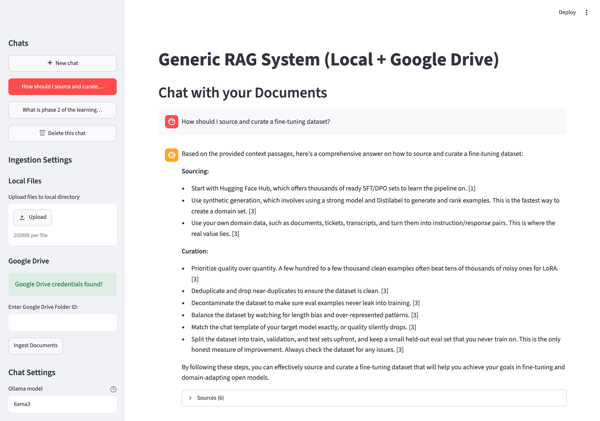
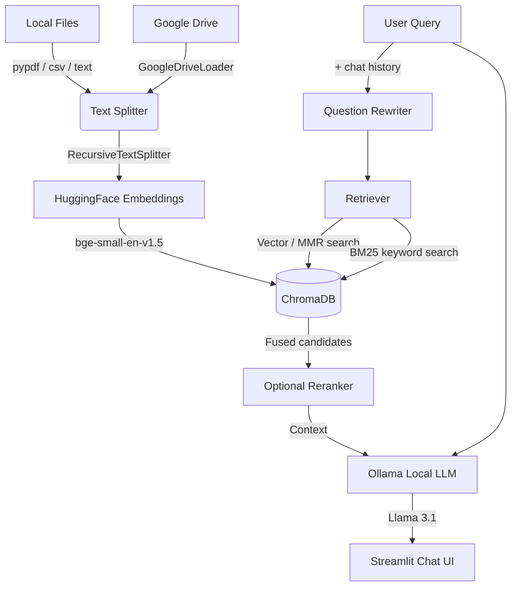

# 📚 PrivateRAG: Local & Cloud Document Intelligence

**A small, readable, well-tested RAG app you can run entirely on your own machine, and fork as a starting point for your own.**

[](https://www.python.org/downloads/)
[](https://langchain.com/)
[](https://ollama.com/)
[](https://opensource.org/licenses/MIT)
[](https://github.com/husseinzayat3/PrivateRAG/actions/workflows/ci.yml)

**PrivateRAG** is a fully open-source, generic Retrieval-Augmented Generation (RAG) architecture that allows you to chat with your local documents and Google Drive folders securely. By leveraging local LLMs through Ollama, this system guarantees 100% data privacy—your documents never leave your machine during the inference process, and usage telemetry from the underlying libraries is turned off.



---

## ✨ Key Features
- **Hybrid Data Ingestion**: Seamlessly ingest `.pdf`, `.txt`, `.md`, and `.csv` files from your local filesystem OR fetch entire directories directly from **Google Drive API**.
- **Privacy First**: Uses [Ollama](https://ollama.com/) to run Large Language Models (like Llama 3.1) entirely locally.
- **Local Embeddings**: Uses `BAAI/bge-small-en-v1.5` via HuggingFace (or any Ollama embedding model, e.g. `nomic-embed-text`) for local vector embeddings without expensive API calls.
- **Better Retrieval**: Hybrid search (BM25 keywords + vectors, fused with reciprocal rank fusion) finds exact names, IDs and error codes that vector search alone misses. MMR and plain vector search are one setting away, and an optional cross-encoder reranker improves passage ordering.
- **Index Management**: See every indexed document with its chunk count, remove documents, clean up files deleted from disk, or reset the index. Re-ingesting an edited file replaces its old chunks.
- **Cited Answers**: Answers cite their sources (`[1]`, `[2]`, …), and the retrieved passages with file and page are shown under each answer.
- **Conversational**: Follow-up questions like "tell me more about that" are rewritten using the chat history before retrieval.
- **Streaming**: Answers stream token by token, and the models are preloaded at startup so the first answer starts sooner.
- **Chat History**: Conversations are saved locally (SQLite) and listed in the sidebar; reopen, continue or delete them. Each chat has its own URL, so a page refresh keeps it open.
- **Persistent Vector Store**: Uses [ChromaDB](https://www.trychroma.com/) for efficient, persistent local vector storage.
- **Interactive UI**: Built on [Streamlit](https://streamlit.io/) for a smooth, intuitive chat and document upload experience.

## 🏗️ Architecture



## 🚀 Quick Start (Docker)

The fastest way to try it. You only need [Docker](https://docs.docker.com/get-docker/):

```bash
git clone https://github.com/husseinzayat3/PrivateRAG.git
cd PrivateRAG
docker compose up
```

Then open **http://localhost:8501**. The first start downloads the chat model (about 4.9 GB for `llama3.1`; follow along with `docker compose logs -f ollama-init`). Later starts take seconds.

- **Your documents:** put files in `./data`, or upload them in the sidebar.
- **NVIDIA GPU:** `docker compose -f docker-compose.yml -f docker-compose.gpu.yml up`
- **Mac:** Docker can't use the Apple GPU. For faster answers, run Ollama natively (see [Troubleshooting](docs/TROUBLESHOOTING.md#which-hardware-do-i-need)) or use the Python install below.
- **Another model:** set `OLLAMA_MODEL_NAME` in `.env` (e.g. `llama3.2:3b` for CPU-only machines).

## 🧪 Try It With the Sample Documents

Click **Add sample documents** in the sidebar, then **Ingest Documents**, and ask:

- _How many vacation days do new employees get, and do unused days carry over?_
- _What does error code E7 on the Orbit X2 mean and how do I fix it?_
- _What caused the March 14 outage?_, then follow up with _"Who owns the second action item?"_

The [sample documents](samples/) are fictional, so the model can't answer from its training data. Every answer has to come from retrieval, with citations you can check under **Sources**.

## 🐍 Install With Python

### 1. Prerequisites
- Python 3.10–3.13
- [Ollama](https://ollama.com/) installed on your machine.

### 2. Installation
Clone the repository and install the required dependencies:
```bash
git clone https://github.com/husseinzayat3/PrivateRAG.git
cd PrivateRAG
python -m venv .venv
source .venv/bin/activate   # Windows: .venv\Scripts\activate
pip install -r requirements.txt
```

### 3. Setup Local LLM
Ensure Ollama is running in the background and pull the `llama3.1` model:
```bash
ollama pull llama3.1
```

### 3b. Configuration (Optional)
All settings have sensible defaults. To change them, copy `.env.example` to `.env` and edit it:
```bash
cp .env.example .env
```

| Setting | Default | Description |
|---|---|---|
| `OLLAMA_MODEL_NAME` | `llama3.1` | Any model pulled with `ollama pull` |
| `OLLAMA_BASE_URL` | `http://localhost:11434` | Ollama server URL |
| `LLM_TEMPERATURE` | `0.2` | Answer randomness |
| `OLLAMA_NUM_CTX` | `8192` | Context window in tokens; must fit the passages plus chat history |
| `OLLAMA_KEEP_ALIVE` | `30m` | How long Ollama keeps the model loaded between questions |
| `EMBEDDING_PROVIDER` | `huggingface` | `huggingface` or `ollama` |
| `EMBEDDING_MODEL_NAME` | `BAAI/bge-small-en-v1.5` | Embedding model (e.g. `nomic-embed-text` with `ollama`) |
| `CHUNK_SIZE` / `CHUNK_OVERLAP` | `1000` / `200` | Text splitting |
| `RETRIEVAL_K` | `6` | Passages retrieved per question |
| `RETRIEVAL_MODE` | `hybrid` | `similarity` (vectors), `mmr` (vectors, favouring diverse passages) or `hybrid` (keywords + vectors) |
| `USE_RERANKER` | `false` | Rerank passages with a cross-encoder (downloads the model on first use) |
| `RERANKER_MODEL` | `cross-encoder/ms-marco-MiniLM-L6-v2` | Any sentence-transformers cross-encoder, e.g. `BAAI/bge-reranker-base` for multilingual documents |
| `MAX_HISTORY_MESSAGES` | `6` | Chat messages used to understand follow-ups |
| `DATA_DIR` | `data` | Folder ingested by **Ingest Documents**; uploads are saved here |
| `CHROMA_DB_DIR` | `chroma_db` | Vector index location |
| `CHAT_DB_PATH` | `chat_history.db` | Chat history database |
| `GDRIVE_CREDENTIALS_PATH` / `GDRIVE_TOKEN_PATH` | `credentials.json` / `token.json` | Google Drive OAuth files |

Relative paths are resolved against the project root. The model, temperature, `k`, retrieval mode and reranker can also be changed live in the sidebar.

> **Tip:** Most of the wait before an answer starts is the model reading the retrieved passages. If answers are slow to start on your hardware, lower `k` or `CHUNK_SIZE`.

> **Note:** Each embedding model gets its own collection in ChromaDB, so after changing `EMBEDDING_PROVIDER` or `EMBEDDING_MODEL_NAME`, click **Ingest Documents** again to index your files with the new model.

> **Managing the index:** Click **Manage index** in the sidebar to see what's indexed, remove documents, or reset the index. After editing files, click **Ingest Documents** again; changed files have their old chunks replaced.

### 4. Google Drive Configuration (Optional)
To enable Google Drive integration, you need an **OAuth 2.0 Client ID** configured as a **Desktop app**:

**1. Enable the API**
- Go to the [Google Cloud Console](https://console.cloud.google.com/).
- Create a new project (or select an existing one).
- In the left sidebar, go to **APIs & Services > Library**.
- Search for **Google Drive API** and click **Enable**.

**2. Configure the OAuth Consent Screen**
- Go to **APIs & Services > OAuth consent screen**.
- Choose **External** and click **Create**.
- Fill in the required fields (App Name, Support Email, Developer Contact).
- Under **Scopes**, click **Add or Remove Scopes** and select `.../auth/drive.readonly`.
- Under **Test users**, add your own Google email address.

**3. Create the Credentials**
- Go to **APIs & Services > Credentials**.
- Click **+ Create Credentials** > **OAuth client ID**.
- Under **Application type**, select **Desktop app** and give it a name.
- Click **Download JSON** on the resulting pop-up.
- Rename that downloaded file to `credentials.json` and place it in the root folder of this project (next to `app.py`).

On your first Google Drive ingestion run, a browser window will open asking you to authenticate. Once authenticated, a `token.json` file will be created automatically. If an existing `token.json` was issued for a different scope, you will be asked to authenticate again.

### 5. Run the Application
Launch the Streamlit interface:
```bash
streamlit run app.py
```

Something not working? See [Troubleshooting & FAQ](docs/TROUBLESHOOTING.md).

## 🛠️ Development
Install the dev tools, then run the linter and tests:
```bash
pip install -r requirements-dev.txt
ruff check .
pytest
```
The tests use fake embeddings and a temporary ChromaDB, so they don't need Ollama or a model download. Both checks run on every push and pull request via [GitHub Actions](.github/workflows/ci.yml), on Python 3.10–3.13.

Contributions are welcome. See [CONTRIBUTING.md](CONTRIBUTING.md) to get started, and [CHANGELOG.md](CHANGELOG.md) for what changed in each release.

## 👨‍💻 About the Author
Built by **Hussein Zayat** - Senior .NET / AI Engineer.
Connect with me on [LinkedIn](https://www.linkedin.com/in/hussein-zayat-6730b6161) or check out my other projects on [GitHub](https://github.com/husseinzayat3).

## 📄 License
This project is licensed under the MIT License - see the [LICENSE](LICENSE) file for details.
