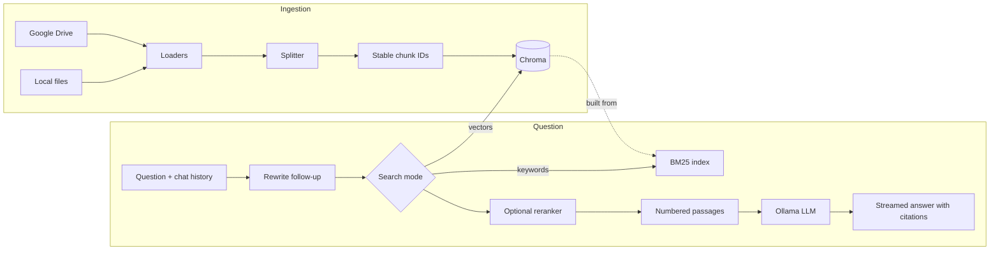

# Architecture

PrivateRAG is about 1,100 lines of Python split across six modules. This document explains
how a document becomes an answer, why the main design decisions were made, and where to
change things when you fork it.

- [Overview](#overview)
- [Modules](#modules)
- [Ingestion](#ingestion)
- [Retrieval](#retrieval)
- [Answering](#answering)
- [Storage](#storage)
- [Extending PrivateRAG](#extending-privaterag)
- [Known limits](#known-limits)

## Overview



Both halves run in the Streamlit process. Ollama is the only other service.

## Modules

| Module | Responsibility | Depends on |
|---|---|---|
| `config.py` | Settings from environment variables / `.env`, paths, version | — |
| `vectorstore.py` | Embedding model, Chroma collection, chunk IDs, listing and deleting documents | config |
| `ingest.py` | File loaders, Google Drive, splitting, storing only what changed | config, vectorstore |
| `retrieval.py` | Search modes (similarity, MMR, hybrid), BM25, rank fusion, reranking | config, vectorstore |
| `rag.py` | Prompts, follow-up rewriting, answer streaming, model warm-up | config, retrieval, vectorstore |
| `chat_store.py` | Chat history in SQLite | config |
| `app.py` | Streamlit UI; the only module that knows about Streamlit | everything above |

The dependencies only point downwards, so everything except `app.py` can be used (and is
tested) without the UI.

## Ingestion

### Loading

`ingest.LOADERS` maps file extensions to loader functions. Each returns LangChain
`Document`s, with `source` (the file path) in their metadata:

| Type | One document per | Extra metadata |
|---|---|---|
| `.pdf` | page | `page` (0-based), `page_label` (the printed page number), `total_pages` |
| `.csv` | row, as `column: value` lines | `row` (0-based) |
| `.txt`, `.md` | file | — |

Text is decoded as UTF-8 (with or without BOM), then Windows-1252, then Latin-1, which
accepts any bytes. A file that fails to load is reported in the UI and skipped; the other
files are still ingested.

Google Drive goes through `GoogleDriveLoader`. Google Docs, Sheets and Slides are exported as
text; PDFs are downloaded and read by the same `pypdf` code as local files. Their `source` is
the Drive URL and their `title` is the file name.

### Chunking and stable IDs

Documents are split with LangChain's `RecursiveCharacterTextSplitter` (`CHUNK_SIZE` 1000 /
`CHUNK_OVERLAP` 200 characters). Each chunk gets a deterministic ID:

```
sha256(source | page | row | chunk text)
```

This one decision makes ingestion **idempotent**: the same content always gets the same ID,
so clicking **Ingest Documents** again only embeds chunks that are actually new. Other
metadata (like PDF producer fields) is left out of the hash, so it can't cause re-embedding.

### Replacing outdated chunks

Files are always loaded whole. So when a file is ingested, any chunk already stored for the
same `source` that isn't in the new set must be from an older version of the file:

```
existing = IDs stored for these sources
new      = IDs of the freshly split chunks
add      = new − existing        (embedded and stored)
remove   = existing − new        (deleted)
```

Editing one page of a 300-page PDF therefore re-embeds about one page, not 300. Files that
were deleted from disk are never part of an ingest, so they're cleaned up separately:
**Manage index** marks them *Missing from disk* and offers to remove them.

### One collection per embedding model

Vectors from different embedding models can't be compared. Each provider/model pair gets its
own Chroma collection (`vectorstore.collection_name()`), so switching models starts an empty
index instead of mixing incompatible vectors. Switching back finds the old index intact.

## Retrieval

`rag.retrieve()` runs in two steps.

**1. Rewrite follow-ups.** If there's chat history, the LLM (at temperature 0) rewrites the
question into a standalone one: "Who owns the second one?" becomes "Who owns the second
action item from the March 14 outage review?". Search needs the full question; the answer
prompt still gets the original question plus the history. The rewrite is shown under
**Sources → Searched for**.

**2. Search** (`retrieval.search()`), in one of three modes:

| Mode | How it works | Good at |
|---|---|---|
| `similarity` | Nearest neighbours by embedding | Paraphrases, questions worded differently from the text |
| `mmr` | Maximal marginal relevance: from the top candidates, picks passages that are relevant **and** different from those already picked (`MMR_LAMBDA` = 0.5) | Repetitive documents |
| `hybrid` (default) | Vector search and BM25 keyword search, merged with reciprocal rank fusion | Everything above, plus exact names, IDs and codes |

### Hybrid search

Embeddings capture meaning but blur exact tokens: to a vector model, "error E7" and "error
E5" look almost the same. BM25 is the opposite. So hybrid search runs both and merges them
with **reciprocal rank fusion (RRF)**: each passage scores `1 / (60 + rank)` in each list it
appears in, and the scores are summed. RRF only uses ranks, so the two incompatible score
scales (cosine similarity vs. BM25) never have to be calibrated against each other.

Each search fetches `max(20, 4 × k)` candidates before fusion, so a passage ranked
moderately by both methods can still win.

The BM25 index (`retrieval.BM25`) is about 30 lines: an inverted index of
`term → [(passage, frequency)]` with the standard Okapi BM25 scoring (k1 = 1.5, b = 0.75).
Tokens are lowercased runs of letters and digits, so `E7` and `INV-2041` stay searchable. It
lives in memory, is built from Chroma on the first hybrid search, and is rebuilt when the index
changes. Changes are detected by a counter in this process plus the chunk count, which also
catches ingestion from another process.

### Reranking (optional)

With **Rerank passages** on, the chosen mode returns its full candidate pool, and a
**cross-encoder** (`RERANKER_MODEL`, default `cross-encoder/ms-marco-MiniLM-L6-v2`) scores
each (question, passage) pair together. That's slower than comparing precomputed embeddings,
but considerably more accurate, which is why it only runs on a few dozen candidates. The top k
are kept.

## Answering

`rag.stream_answer()` builds a prompt from:

1. The system prompt (`ANSWER_SYSTEM_PROMPT`): answer only from the passages, cite them as
   `[1]`, `[2]`, and say so when the answer isn't there.
2. The last `MAX_HISTORY_MESSAGES` chat messages (failed answers are left out).
3. The passages, numbered and labelled, e.g. `[2] (Source: report.pdf, p. 4)`, followed by
   the question.

The answer streams token by token from Ollama. `OLLAMA_NUM_CTX` (default 8192 tokens) must
fit the passages plus the history, because Ollama silently truncates longer prompts. The
numbered passages are saved with the answer, which is how **Sources** shows exactly what the
citation numbers refer to, even when you reopen an old chat.

At startup, `rag.warm_up()` loads the embedding model, the reranker (if on) and the Ollama
model in a background thread, so the first question doesn't pay for loading them.

## Storage

| Path (default) | Contents | Safe to delete? |
|---|---|---|
| `data/` | Your documents (uploads are saved here) | It's your data |
| `chroma_db/` | Chroma: chunk text, embeddings and metadata, one collection per embedding model | Yes; re-ingest to rebuild |
| `chat_history.db` | SQLite: `chats` and `messages` tables; each answer stores its sources as JSON | Yes; deletes all chats |
| `token.json` | Google Drive OAuth token (read-only scope) | Yes; you'll sign in again |

All paths are configurable (`DATA_DIR`, `CHROMA_DB_DIR`, `CHAT_DB_PATH`,
`GDRIVE_TOKEN_PATH`). Docker Compose keeps them in `./data` and the `storage` volume.

## Extending PrivateRAG

Common changes, and where they go:

- **Support a new file type:** write a `load_xyz(path)` function in `ingest.py` that returns
  `Document`s with `source` in their metadata, add it to `LOADERS`, and add a test in
  `tests/test_loading.py`. The upload widget picks up the new extension automatically.
- **Add a search mode:** add it to `retrieval.MODES` (key and label) and a branch in
  `retrieval.search()`. The sidebar lists it automatically. Add a case to
  `test_search_modes_return_k_distinct_chunks`.
- **Use a different LLM:** `rag.get_llm()` returns a LangChain chat model; any model with
  `.stream()` works, e.g. `ChatOpenAI` pointed at a local OpenAI-compatible server.
- **Use different embeddings:** `vectorstore.get_embeddings()`. A new model automatically
  gets its own collection.
- **Change the prompts:** `CONDENSE_SYSTEM_PROMPT` and `ANSWER_SYSTEM_PROMPT` in `rag.py`.
  Keep the citation instruction, because the sources panel relies on it.
- **Use the pipeline without the UI:** everything except `app.py` is plain Python:

  ```python
  from ingest import chunk_and_store, ingest_local_files
  from rag import retrieve, stream_answer

  docs, errors = ingest_local_files()
  chunk_and_store(docs)
  query, passages = retrieve("What does error E7 mean?")
  print("".join(stream_answer("What does error E7 mean?", passages)))
  ```

## Known limits

- **Single user, no authentication.** Run it locally, or put authentication in front of it
  (see [SECURITY.md](../SECURITY.md)).
- **Ingestion blocks the UI** while it runs, with a single spinner.
- **The BM25 index is in memory.** It takes roughly 120 MB and 1–3 seconds to build per 10,000
  chunks; searching it takes milliseconds. It's rebuilt on the first hybrid search after each
  ingest, so very large indexes (100k+ chunks) see a noticeable pause there. Use
  `RETRIEVAL_MODE=similarity`, or persist the index, if that matters for you.
- **Scanned PDFs** (images of text) have no text to extract; there's no OCR.
- **Chunking is by characters**, not tokens or document structure (headings, tables).
